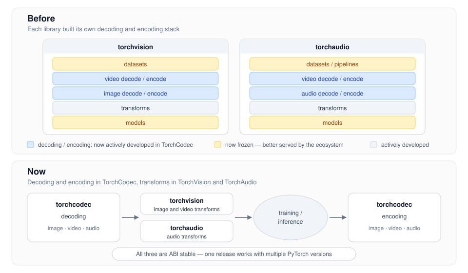

<!-- _paginate: false -->

## ⚠️ Note for reviewers

**Status: very draft, vibed.**

- The relevant content is there, and should be enough to decide whether comms / legal review is needed.
- Visuals (template), phrasing, etc. will be heavily adjusted.

---

<!-- _class: lead -->
<!-- _paginate: false -->

# From Bytes to Tensors: Efficient Media Processing with PyTorch in 2026

Nicolas Hug (META), Scott Schneider (META)

---

## Plan

<div class="libs">
<div class="lib">TorchCodec<small>decode &amp; encode</small></div>
<div class="lib">TorchVision<small>image &amp; video transforms</small></div>
<div class="lib">TorchAudio<small>audio transforms</small></div>
</div>

<div class="columns">
<div class="card">

### Part 1: The landscape
Where these three libraries landed: who does what, and how they fit together

</div>
<div class="card">

### Part 2: Going fast
How to make your media pipeline fast with these three libraries, using existing and new features

</div>
</div>

---

## The PyTorch media stack: before and now

<div style="text-align: center">



</div>

<!--
Before: decoding/encoding scattered and duplicated across TV and TA.
TV: io.read_video, io.VideoReader, 3 backends (PyAV, C++ FFmpeg, CUDA) - only PyAV out of the box.
TA: StreamReader/StreamWriter + audio utils on FFmpeg / libsoundfile / libsox.
Now: one job per library.
-->

<div class="tuto">📖 Blog post: <a href="https://pytorch.org/blog/evolution-of-the-pytorch-media-processing-landscape/">Evolution of the PyTorch media processing landscape</a></div>

---

## One job per library

<div class="three">
<div class="card">

### TorchCodec
**Decode & encode**
images · video · audio
CPU and CUDA

</div>
<div class="card">

### TorchVision
**Transform**
images and video
resize, crop, augment…

</div>
<div class="card">

### TorchAudio
**Transform**
audio
spectrograms, resampling…

</div>
</div>

<br>

Why all media I/O moved to TorchCodec:
- **Clearer for users**: one place for all decoding and encoding, designed as a whole
- **Performance**: all optimization effort goes into one library
- **Simpler packaging and maintenance**: the hard C/C++ dependencies (FFmpeg 4–9, NVDEC, libjpeg, libpng…) are contained in TorchCodec

---

<!-- _class: dense -->

## How they fit together

TorchCodec's <strong class="orange">output</strong> is TorchVision's and TorchAudio's <strong class="orange">input</strong>


<div class="pipeline">
<div class="stage">encoded media<small>files, bytes</small></div><div class="arrow">→</div>
<div class="stage hl">TorchCodec<small>decode</small></div><div class="arrow">→</div>
<div class="stage">tensors</div><div class="arrow">→</div>
<div class="stage hl">TorchVision / TorchAudio<small>transform</small></div>
</div>

<div class="statement">

</div>

<div class="columns">
<div>

**Video**: TorchCodec → TorchVision

```python
import torch
from torchcodec.decoders import VideoDecoder
from torchvision.transforms import v2

clip = VideoDecoder("video.mp4")[10:20]
# uint8 tensor, (10, C, H, W)

transform = v2.Compose([
    v2.RandomResizedCrop(224),
    v2.ToDtype(torch.float32, scale=True),
])
batch = transform(clip)
```

</div>
<div>

**Audio**: TorchCodec → TorchAudio

```python
from torchcodec.decoders import AudioDecoder
from torchaudio.transforms import MelSpectrogram

decoder = AudioDecoder("audio.mp3")
samples = decoder.get_all_samples()

mel = MelSpectrogram(
    sample_rate=samples.sample_rate
)(samples.data)
```

Encoding goes the other way:
`VideoEncoder`, `AudioEncoder`, …

</div>
</div>

---

## TorchVision and TorchAudio are **not** deprecated

- They're **focused**: transforms are what the community uses most, so that's where the effort goes
- Models, datasets, pipelines: no longer under active development, better served by the ecosystem (e.g. HuggingFace)

<div class="card">

### All three libraries are now ABI stable
- A release is no longer tied to a single PyTorch version: it **keeps working with the PyTorch versions that come after it**
- No rebuild for every PyTorch release → release cadences no longer match PyTorch's, **and that's expected**

</div>

<span class="muted">Still on `torchvision.io` / `torchaudio` decoding? → TorchCodec [migration guide](https://meta-pytorch.org/torchcodec/main/generated_examples/migration/torchvision_migration.html)</span>

<div class="tuto">📖 Docs: <a href="https://docs.pytorch.org/docs/2.14/notes/libtorch_stable_abi.html">LibTorch stable ABI</a></div>

---

<!-- _class: divider -->
<!-- _paginate: false -->

# Part 2: Going fast

<div class="pipeline">
<div class="stage">open<small>read headers, index the file</small></div><div class="arrow">→</div>
<div class="stage">decode<small>encoded bytes → RGB tensors</small></div><div class="arrow">→</div>
<div class="stage">transform<small>resize, crop, normalize…</small></div>
</div>

Every stage can be the bottleneck. Let's go through them in order.

---

<!-- _class: divider -->

<div class="pipeline">
<div class="stage hl">open</div><div class="arrow">→</div>
<div class="stage">decode</div><div class="arrow">→</div>
<div class="stage">transform</div>
</div>

# Opening the video

---

## Open from anywhere

```python
decoder = VideoDecoder("video.mp4")   # path, bytes, tensor of bytes
```


But also <strong class="orange">file-like objects!</strong>


```python
import fsspec

with fsspec.open("https://.../video.mp4") as f:   # or s3://, gs://, ...
    decoder = VideoDecoder(f, seek_mode="approximate")
    frame = decoder[1000]
```

- `decoder[1000]` **seeks** to 1000: only the bytes around there are downloaded, **not the whole file from the start**

<div class="tuto">📖 Tutorial: <a href="https://meta-pytorch.org/torchcodec/main/generated_examples/decoding/file_like.html">Streaming data through file-like support</a></div>

---

<!-- _class: dense -->

## Exact vs approximate seek mode

```python
decoder = VideoDecoder("long_video.mp4", seek_mode="approximate")
```


A tradeoff: <strong class="orange">seek accuracy</strong> vs <strong class="orange">decoder creation speed</strong>

| | `"exact"` (default) | `"approximate"` |
|---|---|---|
| **Creation** | scans the whole file: slow on long videos | reads the header: fast |
| **Seeking** | frame-accurate | may be slightly off on some files |

<div class="result">
<div class="label">📊 Benchmark: remote 10 min 720p video (209 MB), create decoder + decode 16 frames</div>
<div><code>"exact"</code>: <strong>236 MB</strong> downloaded</div>
<div><code>"approximate"</code>: <strong>28 MB</strong> downloaded</div>
</div>

<!--
bench.py seek_mode: bytes read from the source, 10 min 720p H.264 (209 MB).
exact: 209.1 MB to create, 236.4 MB to create + decode 16 equally spaced frames.
approximate: 0.3 MB to create, 27.5 MB to create + decode 16 frames.
Local file, page-cached: creation 40 ms (exact) vs 4.4 ms (approximate).
-->

<div class="tuto">📖 Tutorial: <a href="https://meta-pytorch.org/torchcodec/main/generated_examples/decoding/approximate_mode.html">Exact vs approximate seek mode</a></div>

---

## Custom frame mappings: exact *and* fast

Pre-compute the index offline. Reuse it every time you decode.

```bash
ffprobe -i video.mp4 -select_streams 0 -show_frames \
        -show_entries frame=pts,duration,key_frame -of json > mappings.json
```

```python
with open("mappings.json") as f:
    decoder = VideoDecoder("video.mp4", custom_frame_mappings=f)
```

**The best of both worlds:**
- Frame-accurate seeking like `"exact"`
- Creation speed like `"approximate"`

<div class="tuto">📖 Tutorial: <a href="https://meta-pytorch.org/torchcodec/main/generated_examples/decoding/custom_frame_mappings.html">Custom frame mappings</a></div>

---

<!-- _class: divider -->

<div class="pipeline">
<div class="stage">open</div><div class="arrow">→</div>
<div class="stage hl">decode</div><div class="arrow">→</div>
<div class="stage">transform</div>
</div>

# Decoding

---

<!-- _class: dense -->

## GPU decoding: `device="cuda"`

```python
decoder = VideoDecoder("video.mp4", device="cuda")
frames = decoder.get_frames_at([0, 10, 20])   # already on the GPU
print(decoder.cpu_fallback)                   # did we silently fall back to CPU?
```

Why it's (usually!) faster:
- **Fast raw decoding** on NVDEC, a dedicated hardware chip separate from the CUDA cores
- **Less PCIe traffic**: encoded packets are much smaller than decoded frames
- **YUV → RGB conversion**: expensive on CPU, extremely fast on GPU

<div class="result">
<div class="label">📊 Benchmark: decode all 300 frames of a 10s video (laptop: RTX 4080)</div>
<div style="display: flex; gap: 40px; align-items: center">
<table>
<tr><th></th><th>CPU</th><th>GPU</th><th>Speedup</th></tr>
<tr><td><strong>1080p</strong></td><td>1466 ms</td><td>370 ms</td><td><strong>4×</strong></td></tr>
<tr><td><strong>4K</strong></td><td>4394 ms</td><td>1430 ms</td><td><strong>3×</strong></td></tr>
</table>
<div style="font-size: 26px"><strong>On a warm cache!</strong></div>
</div>
</div>

<!--
bench.py gpu_decoding, median of 10 runs, NVDEC cache warm. CPU = 1 FFmpeg thread.
GPU decoding barely uses the CPU.
The laptop GPU has 1 NVDEC; GB200 / B200 / H100 have 7, A100 has 5.
-->

<div class="tuto">📖 Tutorials: <a href="https://meta-pytorch.org/torchcodec/main/generated_examples/decoding/basic_cuda_example.html">CUDA decoding</a> · <a href="https://meta-pytorch.org/torchcodec/main/generated_examples/decoding/image_decoding.html">Image decoding</a></div>

---

## GPU decoding: the NVDEC decoder cache

Creating and destructing a `VideoDecoder` is very expensive!
TorchCodec **caches and reuses** the underlying hardware resources.

```python
from torchcodec.decoders import set_nvdec_cache_capacity

set_nvdec_cache_capacity(64)   # default: 20 decoders per GPU
```

- A cached decoder is reused for a new video with the same codec and frame dimensions (LRU eviction)
- **tune the capacity!**

<div class="result">
<div class="label">📊 Benchmark: create GPU decoder + decode 10 frames, 10s 1080p video (laptop: RTX 4080)</div>
<div style="display: flex; gap: 40px; align-items: center">
<table>
<tr><th>No cache</th><th>Warm cache</th><th>Speedup</th></tr>
<tr><td>272 ms</td><td>24 ms</td><td><strong>11×</strong></td></tr>
</table>
<div style="font-size: 24px"><strong>Matters even more when decoding many videos in parallel</strong></div>
</div>
</div>

<!--
bench.py nvdec_cache, median of 20 runs. "No cache" = set_nvdec_cache_capacity(0).
-->

---

<!-- _class: dense -->

## Parallel decoding: 4 strategies

<div class="strategies">
<div class="strategy">

**① One long video**: one decoder per chunk

<div class="vlabel">video 1</div>
<div class="vbar c1"><div class="seg">chunk 1</div><div class="seg">chunk 2</div><div class="seg">chunk 3</div><div class="seg">chunk 4</div></div>
<div class="decs"><div><span>VideoDecoder</span></div><div><span>VideoDecoder</span></div><div><span>VideoDecoder</span></div><div><span>VideoDecoder</span></div></div>

</div>
<div class="strategy">

**② Many videos**: one decoder per video

<div class="vlabel">&nbsp;</div>
<div class="vids"><div class="vbar c1"><div class="seg">video 1</div></div><div class="vbar c2"><div class="seg">video 2</div></div><div class="vbar c3"><div class="seg">video 3</div></div><div class="vbar c4"><div class="seg">video 4</div></div></div>
<div class="decs"><div><span>VideoDecoder</span></div><div><span>VideoDecoder</span></div><div><span>VideoDecoder</span></div><div><span>VideoDecoder</span></div></div>

</div>
<div class="strategy">

**③ FFmpeg threads**: decode upcoming frames ahead, into a buffer

`VideoDecoder(path, num_ffmpeg_threads=4)`

</div>
<div class="strategy">

**④ Low-level APIs**: parallelize stage by stage. Next slides!

</div>
</div>

<p class="spaced"><strong class="orange">All strategies compose!</strong> ① and ② run on threads or processes: decoding releases the GIL.</p>

<div class="result">
<div class="label">📊 Benchmark: decode all 18000 frames of a 10min 720p video (laptop CPU, 4 workers)</div>
<table>
<tr><th>Sequential</th><th>① 4 threads</th><th>① 4 processes</th><th>③ 4 FFmpeg threads</th></tr>
<tr><td>32.7 s</td><td>8.7 s (<strong>3.7×</strong>)</td><td>9.3 s (<strong>3.5×</strong>)</td><td>15.3 s (<strong>2.1×</strong>)</td></tr>
</table>
</div>

<!--
bench.py parallel_decoding, median of 3 runs, pinned to 4 performance cores (taskset -c 0,2,4,6).
① = 4 chunks, one single-threaded decoder per chunk. Chunking scales ~linearly on uniform cores (2 workers: 1.98x, 4: 3.91x).
FFmpeg threads plateau: ~19% of the work stays serial (consistent with single-threaded color conversion).
-->

<div class="tuto">📖 Tutorial: <a href="https://meta-pytorch.org/torchcodec/main/generated_examples/decoding/parallel_decoding.html">Parallel video decoding</a></div>

---

<!-- _class: top -->

## Low-level decoding APIs - New!

<div class="short pipeline">
<div class="stage">open</div><div class="arrow">→</div>
<div class="stage hl">decode</div><div class="arrow">→</div>
<div class="stage">transform</div>
</div>

<div class="tuto">📖 Tutorial: <a href="https://meta-pytorch.org/torchcodec/main/generated_examples/low_level/basics.html">Build your own decoding pipeline</a></div>

---

<!-- _class: top -->

## Low-level decoding APIs - New!

<div class="short pipeline">
<div class="stage">open</div><div class="arrow">→</div>
<div class="stage hl">decode</div><div class="arrow">→</div>
<div class="stage">transform</div>
</div>
<div class="zoom-funnel"></div>
<div class="zoom-box">
<div class="pipeline">
<div class="stage">demux<small>Demuxer</small></div><div class="arrow">→<small>Packet</small></div>
<div class="stage">decode<small>VideoPacketDecoder</small></div><div class="arrow">→<small>RawFrame (YUV)</small></div>
<div class="stage">color convert<small>ColorConverter</small></div><div class="arrow">→<small>Frame (RGB)</small></div>
</div>
</div>

`VideoDecoder` runs all three stages in one call. The low-level APIs expose each of them.

<div class="tuto">📖 Tutorial: <a href="https://meta-pytorch.org/torchcodec/main/generated_examples/low_level/basics.html">Build your own decoding pipeline</a></div>

---

## Low-level APIs: the basic loop

```python
from torchcodec.decoders import ColorConverter, Demuxer

demuxer = Demuxer("video.mp4", streams="video")
packet_decoder = demuxer.streams[0].make_decoder()
color_converter = ColorConverter()

for packet in demuxer:
    for raw_frame in packet_decoder.decode(packet):
        frame = color_converter.convert(raw_frame)

# Same as VideoDecoder("video.mp4).get_all_frames()
```

- One object per stage: you control where and when each one runs
- On GPU: `make_decoder(device="cuda")` and `ColorConverter(device="cuda")`
- A `Demuxer` can follow **several streams at once**: audio + video in a single pass

<div class="tuto">📖 Tutorial: <a href="https://meta-pytorch.org/torchcodec/main/generated_examples/low_level/basics.html">Build your own decoding pipeline</a></div>

---

<!-- _class: dense -->

## Multi-stream decoding: audio + video in one pass

<div class="pkts-label">Demuxer: interleaved packets from one file</div>
<div class="pkts"><div class="pkt v">V</div><div class="pkt a">A</div><div class="pkt v">V</div><div class="pkt v">V</div><div class="pkt a">A</div><div class="pkt v">V</div><div class="pkt a">A</div><div class="pkt v">V</div><div class="pkt v">V</div><div class="pkt a">A</div><div class="pkt v">V</div><div class="pkt a">A</div></div>
<div class="lanes arrows"><div>↓ video packets</div><div>↓ audio packets</div></div>
<div class="lanes">
<div class="lane v">VideoPacketDecoder → ColorConverter → frames</div>
<div class="lane a">AudioPacketDecoder → AudioConverter → samples</div>
</div>

```python
demuxer = Demuxer("video.mp4", streams=("video", "audio"))
video_stream, audio_stream = demuxer.streams
decoders = {s.index: s.make_decoder() for s in demuxer.streams}
color_converter, audio_converter = ColorConverter(), AudioConverter()

for packet in demuxer:
    for raw in decoders[packet.stream_index].decode(packet):
        if packet.stream_index == video_stream.index:
            frame = color_converter.convert(raw)
        else:
            samples = audio_converter.convert(raw)
```

- **Read the file once**, instead of once per stream
- Also works for several video streams or audio tracks: `streams="all"`

<div class="tuto">📖 Tutorial: <a href="https://meta-pytorch.org/torchcodec/main/generated_examples/low_level/basics.html">Build your own decoding pipeline</a></div>

---

## Low-level APIs: multi-threaded pipelines

Each stage **releases the GIL** → run stages concurrently on threads.

```python
def convert_on_own_thread(device):
    # [demux + decode] on one thread || [color convert] on another
    raw_frames = prefetch(decode(packet_decoder, demux(demuxer)))
    return color_convert(color_converter, raw_frames)
```

`prefetch()` = run the upstream generator on a background thread, through a bounded queue.

Where to split depends on where the work is:
- **CPU**: color conversion is costly → put it on its own thread
- **CUDA**: decoding dominates → put demuxing on its own thread

<div class="todo">TODO benchmark: VideoDecoder vs sequential vs convert_on_own_thread</div>

<div class="tuto">📖 Tutorial: <a href="https://meta-pytorch.org/torchcodec/main/generated_examples/low_level/pipelines.html">Multi-threaded decoding pipelines</a></div>

---

## Low-level APIs: raw YUV and HDR

<div class="columns">
<div>

**Raw YUV planes**: no conversion, no copy

```python
for raw_frame in packet_decoder.decode(packet):
    Y, U, V = raw_frame.planes
    raw_frame.bit_depth  # 10 for HDR
```

- 10-bit HDR → `uint16` planes, every bit intact
- Write your own color conversion, or train in YUV space

</div>
<div>

**HDR with `VideoDecoder`** (beta)

```python
VideoDecoder(path, output_dtype=torch.float32)
VideoDecoder(path, output_dtype="auto")
# SDR -> uint8, HDR -> float32
```

**Also unlocked by the low-level APIs:**
- Endless sources: live streams, pipes

</div>
</div>

<div class="tuto">📖 Tutorials: <a href="https://meta-pytorch.org/torchcodec/main/generated_examples/low_level/raw_data.html">Raw frames and raw audio samples</a> · <a href="https://meta-pytorch.org/torchcodec/main/generated_examples/decoding/hdr_decoding.html">Decoding HDR videos</a></div>

---

<!-- _class: divider -->

<div class="pipeline">
<div class="stage">open</div><div class="arrow">→</div>
<div class="stage">decode</div><div class="arrow">→</div>
<div class="stage hl">transform</div>
</div>

# Transforming

---

<!-- _class: dense -->

## Images: the fast pipeline

<div class="pipeline">
<div class="stage hl">decode_image<small>uint8, channels-last</small></div><div class="arrow">→</div>
<div class="stage hl">resize / crop<small>on uint8!</small></div><div class="arrow">→</div>
<div class="stage">ToDtype<small>float32</small></div><div class="arrow">→</div>
<div class="stage">Normalize</div>
</div>

```python
from torchcodec.decoders import decode_image
from torchvision.transforms import v2

img = decode_image("image.jpg")   # uint8 (C, H, W), channels-last memory: ready for resize

transforms = v2.Compose([
    v2.RandomResizedCrop(size=(224, 224), antialias=True),   # uint8 + channels-last: SIMD fast path
    v2.ToDtype(torch.float32, scale=True),                   # convert to float *after* resizing
    v2.Normalize(mean=[0.485, 0.456, 0.406], std=[0.229, 0.224, 0.225]),
])
out = transforms(img)
```

- `decode_image`: JPEG, PNG, WebP, GIF, AVIF, HEIC, format detected from the data
- **No PIL anywhere**: no PIL decoding, no PIL → tensor copy

<div class="todo">TODO: mention batched CUDA decoding, <code>decode_jpeg(list_of_jpegs, device="cuda")</code> (nvJPEG)</div>

---

<!-- _class: dense -->

## TorchVision transforms: why it's fast

1. Use **`torchvision.transforms.v2`**
2. Use **tensors**, not PIL images
3. Use **`torch.uint8`**, especially for resizing: the SIMD kernels (AVX2, NEON) are for `uint8`
4. Resize with bilinear, bicubic or **lanczos**
5. Mind the **memory format**: resize prefers channels-last, which is what TorchCodec outputs

TorchCodec decodes images and video frames straight to `uint8` channels-last tensors: **exactly what resize wants**.

<span class="muted">Shape is `(C, H, W)` / `(N, C, H, W)` but memory is channels-last: avoid calling `.contiguous()` before resizing.</span>

<div class="tuto">📖 Docs: <a href="https://docs.pytorch.org/vision/stable/transforms.html#performance-considerations">TorchVision transforms performance considerations</a></div>

---

## New: Lanczos interpolation

```python
v2.Resize(size=(224, 224), interpolation=v2.InterpolationMode.LANCZOS)
```

- Alongside bilinear and bicubic
- SIMD-optimized on **x86 (AVX2)** and **ARM (NEON)**
- CPU, with `antialias=True`

<div class="todo">TODO benchmark: resize PIL vs TorchVision float vs TorchVision uint8, bilinear / bicubic / lanczos, on x86 and ARM</div>

---

<!-- _class: dense -->

## Decoder-native transforms

Apply transforms **during** decoding, inside TorchCodec:

```python
from torchcodec.transforms import Resize
decoder = VideoDecoder("video.mp4", transforms=[Resize(size=(480, 640))])

# TorchVision transforms work too (but TorchVision is not required)
decoder = VideoDecoder("video.mp4", transforms=[v2.Resize(size=(480, 640))])
```

- Supported: `Resize`, `CenterCrop`, `RandomCrop`
- Main win: **memory**, full-resolution frames are never materialized
- Can also be faster with multiple FFmpeg threads: measure on your setup

<div class="todo">TODO benchmark: memory and time, decoder transforms vs TorchVision after decoding</div>

<div class="tuto">📖 Tutorial: <a href="https://meta-pytorch.org/torchcodec/main/generated_examples/decoding/transforms.html">Decoder transforms</a></div>

---

## Audio: `WavDecoder`

```python
from torchcodec.decoders import WavDecoder

samples = WavDecoder("audio.wav").get_all_samples()
```

- Reads WAV data directly, **bypassing FFmpeg** entirely
- Same `get_all_samples()` / `get_samples_played_in_range()` as `AudioDecoder`
- Use it for WAV without resampling or channel remixing; otherwise use `AudioDecoder`

<div class="todo">TODO benchmark: WavDecoder vs AudioDecoder on WAV files</div>

<div class="tuto">📖 Tutorial: <a href="https://meta-pytorch.org/torchcodec/main/generated_examples/decoding/performance_tips.html">Performance tips</a></div>

---

## And on the way out: encoding

```python
from torchcodec.encoders import Encoder

encoder = Encoder()
video = encoder.add_video(height=1080, width=1920, frame_rate=30, device="cuda")
audio = encoder.add_audio(sample_rate=44100, num_channels=2)

with encoder.open_file("output.mp4"):
    video.add_frames(frames)
    audio.add_samples(samples)
```

- Multiple video and audio streams in one container
- Mix CPU and CUDA video streams, feed data incrementally
- Simpler one-shot encoders too: `VideoEncoder`, `AudioEncoder`, `JpegEncoder`, `PngEncoder`

<div class="tuto">📖 Tutorials: <a href="https://meta-pytorch.org/torchcodec/main/generated_examples/encoding/multi_stream_encoding.html">Multi-stream encoding</a> · <a href="https://meta-pytorch.org/torchcodec/main/generated_examples/encoding/video_encoding.html">Video encoding</a></div>

---

## Cheat sheet

| Symptom | Fix |
|---|---|
| Videos in the cloud | File-like objects (e.g. `fsspec`) |
| Slow to open long videos | `seek_mode="approximate"` or custom frame mappings |
| CPU saturated by decoding, GPU starved | `device="cuda"`, tune `set_nvdec_cache_capacity()`, batched `decode_jpeg` |
| Decoding many frames / many videos | Threads or processes, `num_ffmpeg_threads` |
| Need more than `VideoDecoder` offers | Low-level APIs: multi-threaded pipelines, raw YUV |
| Slow image pipeline | `decode_image` → TorchVision v2 on `uint8` (SIMD), then `ToDtype`, not PIL |
| High memory from high-res frames | Decoder-native transforms |
| Slow WAV decoding | `WavDecoder` |

<br>

<div class="tuto">📖 Tutorial: <a href="https://meta-pytorch.org/torchcodec/main/generated_examples/decoding/performance_tips.html">TorchCodec performance tips</a></div>
